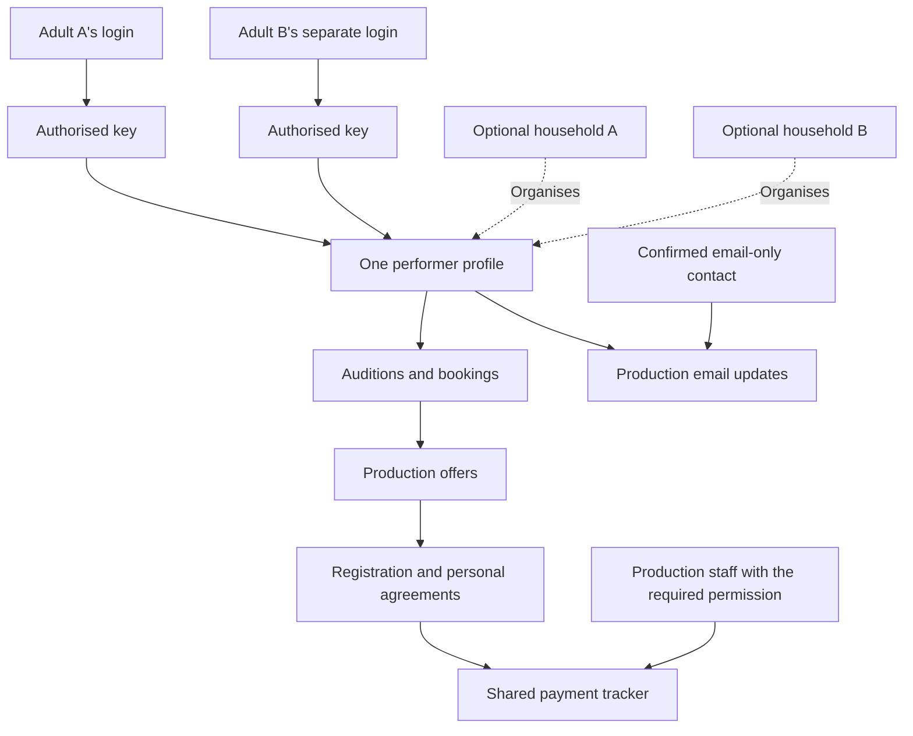

# Households, explained

The household feature gives each adult their own front-door key. Sharing a password is unnecessary.

## The map

A **login** identifies the adult. A **profile** describes the performer. A **household** groups people for convenience. An **access key** is the database's permission connecting a login to a profile. An **email contact** receives messages; that alone does not open the profile.

Household membership alone gives no performer access. Split guardians may keep separate households and have two independent keys to the same child. Everyone with access to that shared performer sees the same financial tracker. There is no division of a bill between parents.

## The twelve pieces

1. **Separate logins and profiles.** Adults log in; children have guardian-managed profiles. A performer keeps one profile across shows. New auditions select or create the profile before saving the booking, rather than waiting for registration. This preserves a continuous history.
2. **Optional households.** A solo adult needs no household. Partners, children and mixed groups can be organised together. Two households can connect to the same child without exposing the rest of either household.
3. **Separate guardian keys.** The primary manager invites another guardian by email. The recipient accepts using their own matching adult login and records a guardian declaration. A copied link or shared surname grants nothing.
4. **Booking help for another adult.** A partner can confirm an emailed permission link without keeping a regular login. The helper can then arrange bookings. The adult can withdraw permission through their emailed receipt, or activate their own login later.
5. **Later activation preserves history.** Activation connects the adult's login to the existing profile and its auditions. It does not create a second performer. Existing duplicate records or conflicting birth dates need review.
6. **Email contacts are separate.** A confirmed email-only contact receives production messages but cannot edit records. Guardians control their own notification preference; another guardian cannot silently turn it off. A changed account email can be confirmed from the household page.
7. **One shared payment tracker.** Authorised keys see fees, discounts, instalment dates, recorded payments and the balance. Production staff record payments. The tracker stores no bank login or card credentials and does not allocate portions between parents. It uses the current registration ledger. Older household logs appear separately with a staff-reconciliation warning, preventing unverified double-counting.
8. **Shared production records.** Profile keys govern auditions, bookings, offers, registrations and related private files. A second guardian can update an existing audition instead of creating another application. Staff permissions remain scoped to the production and page.
9. **Protected access changes.** The primary manager controls new invitations. An added guardian cannot remove the creator. Guardian removals and primary-manager handovers require an operator decision. Being the original creator is an application permission, not proof of legal custody. Adults control their own delegated booking access.
10. **Reviewed linking and duplicates.** A login can connect its own unlinked audition where the birth dates agree. Missing records and duplicate profiles or logins use a review request. Operators verify the people involved before connecting records. Profiles are archived rather than silently destroyed; Auth users are not automatically deleted or merged.
11. **Age, declarations and history.** Guardian access closes at 18, including the original creator's access. Activation of the adult's own account is reviewed when needed. Booking help does not permit signing another adult's personal agreements; they activate their own login for those. Important booking/profile/access changes are recorded in a change history and queued for notification.
12. **Verification and rollout.** Database boundary tests, an exact hosted rollback rehearsal, isolated browser checks and live permission checks accompany this release. Database changes, email workers and website files are deployed together. No real invitation or test email is sent during automated verification.

## What happens when someone auditions?

1. They choose a show and time. The browser remembers that choice during login; it does not reserve a space indefinitely.
2. An adult signs in or creates their login, then chooses an existing performer or creates their own/child profile. Another adult first confirms booking permission.
3. The database checks the key, saves the canonical performer connection and rejects an active duplicate application for that show or booking for that session.
4. Production templates generate separate email copies for the currently authorised/confirmed contacts.
5. If cast, the existing profile continues through the offer and registration. Guardians can manage a child; an adult signs their own personal agreements.
6. Staff payment records feed the shared read-only tracker.

## What this release does not certify

The household feature is separate from the remaining whole-site security/privacy checklist. It does not certify legal compliance in every English-speaking country, verify legal custody, complete a contested family review, repair every historical record, turn scheduled volunteer shifts into verified attendance, or provide a transactional capacity hold. Volunteer account records remain scoped by the existing volunteer system; household performer access is not automatic access to another adult's volunteer account. Tickets remain excluded.

The password-reset email's actual link/button and recovery journey still need their own end-to-end verification. Receiving an email alone does not prove password recovery works.

There are ten historical household payment-log rows in the hosted database at preflight. Their content was not retrieved or changed. If one belongs to a displayed invoice, that invoice warns that production staff must reconcile it with the registration records before treating the balance as final. No balance was silently rewritten.

Legal/privacy launch review remains necessary for the actual countries served, organisational responsibilities, notices, lawful basis, consent where required, retention, deletion and incident response. An age checkbox and an invited guardian declaration are not universal legal proof. See `account-access.md` for the wider checklist and prior official guidance.
